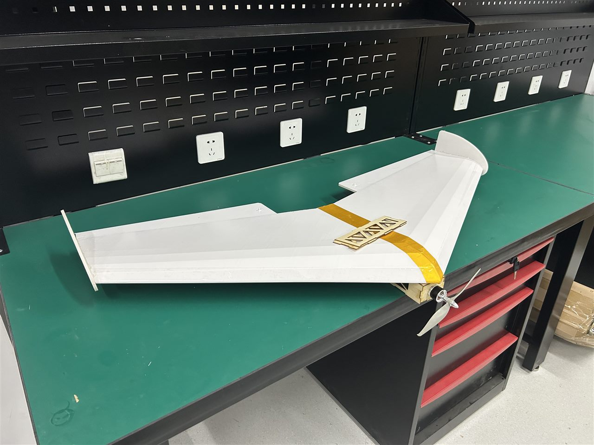
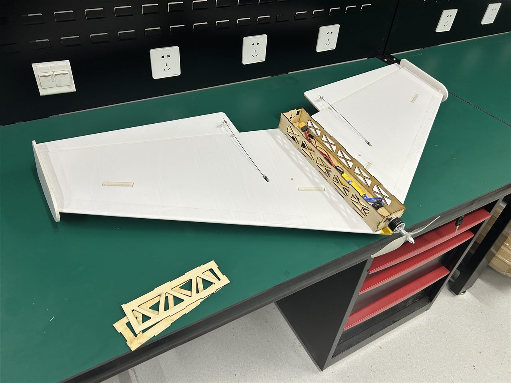
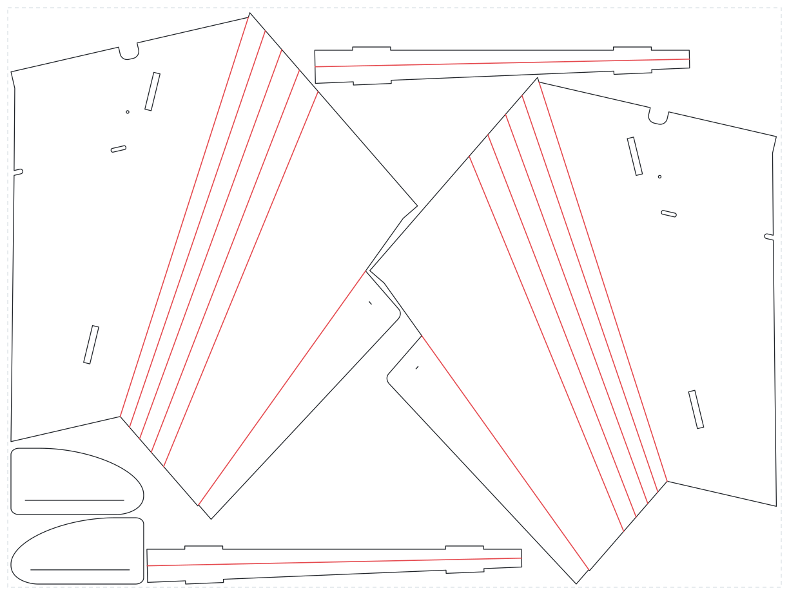
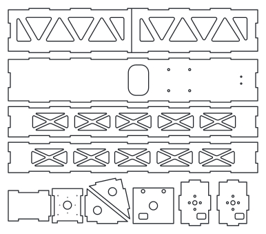

# Modified FT Versa Wing

**A foam-board flying wing you can cut in one sheet and build in about 30 minutes, 
with a laser-cut wooden bay for FPV gear and a choice of tractor or pusher motor.**

Based on the [Flite Test Versa Wing](https://www.flitetest.com/articles/ft-versa-wing-build).

**English** · [简体中文](README.zh-CN.md)

### [⬇ Download the cut files (.zip)](https://github.com/chchaoo/Modified-FTVersaWing/releases/latest/download/versa-wing-plans.zip)

 

## At a glance

| | |
|---|---|
| **Airframe** | 5 mm cold-laminated foam board (KT board), one 1200 × 900 mm sheet |
| **Bay** | 2 mm plywood, laser cut |
| **Board cost** | about ¥5 |
| **Build time** | about 30 minutes |
| **Motor** | tractor, pusher, or both |
| **FPV ready** | M2.5 holes on the 30.5 × 30.5 mm FPV stack pattern for the video transmitter, plus camera mounting holes |
| **Heaviest setup flown** | 2317 1400 KV pusher, 8060 two-blade prop, 4S2P 3300 mAh pack |

## Cut files

| File | What it is |
|---|---|
| [`plans/versa-wing-foam-v2-1200x900.dxf`](plans/versa-wing-foam-v2-1200x900.dxf) | All foam parts, laid out on a 1200 × 900 mm sheet |
| [`plans/versa-wing-wood-bay.dxf`](plans/versa-wing-wood-bay.dxf) | The wooden fuselage bay, 2 mm plywood |

> [!IMPORTANT]
> **Red lines: cut half way through** (fold lines and hinges). **Black and blue lines: cut all the way through.**

The drawings are plain DXF in millimetres and open in any laser-cutter software, LightBurn, LibreCAD or AutoCAD. Without a laser cutter, print them at 1:1 and cut by hand.

## Build notes

- The motor can go at the front (tractor), at the back (pusher), or both.
- The wooden bay already has the M2.5 holes for a 30.5 × 30.5 mm video transmitter and holes for a camera.
- Cut your own openings in the **top surface** for the GPS and the video antenna.
- Any motor and prop will do **as long as the centre of gravity balances**. Move the battery to trim it.

## What you need

**Tools:** a laser cutter (optional), hot glue gun, hobby knife, steel ruler, pliers.

**Materials:** 5 mm cold-laminated foam board, 2 mm plywood, control horns, metal clevises, wire pushrods, velcro, fibre tape, clear or coloured tape, foam tape, CA glue (502), velcro straps.

**Electronics:** motor, propeller, ESC, battery, 2 servos, transmitter and receiver. For FPV: flight controller, video transmitter, camera and a video receiver or goggles.

## Credits

The original FT Versa Wing was designed by [Flite Test](https://www.flitetest.com/articles/ft-versa-wing-build). This repository contains a modified layout and a new wooden bay.

## More designs

- [RCPlane-SU27](https://github.com/chchaoo/RCPlane-SU27): a Su-27 from 5 mm foam board, ducted-fan or propeller version, about 15 minutes to build.

## License

[CC BY-NC-SA 4.0](LICENSE): build it, modify it and share it, with credit, not for commercial use, and under the same license. The original Versa Wing design remains the work of Flite Test; the license covers the modifications and the files in this repository.
